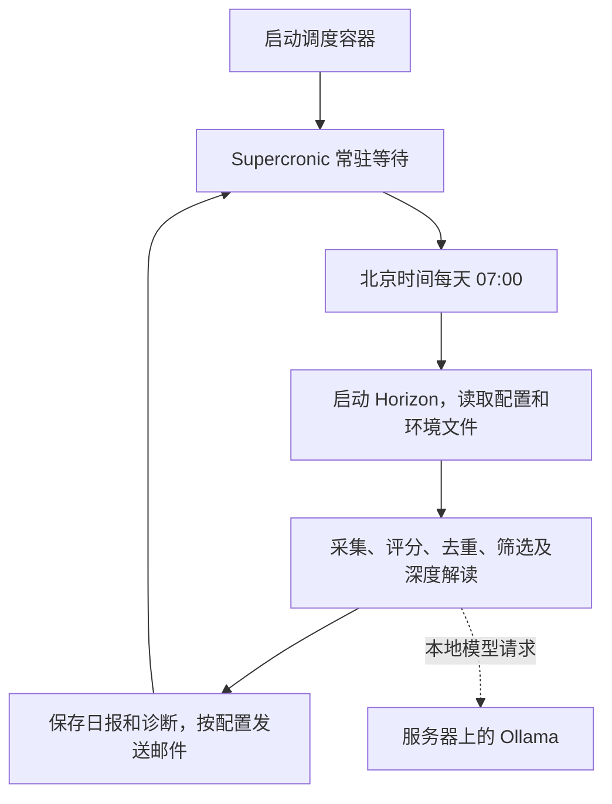

# Horizon Docker 每日运行原理与操作指南

本文介绍如何将 Horizon 和定时任务一起部署到局域网服务器，在每天北京时间
07:00 自动采集资讯、生成日报并按配置发送邮件。

适用环境：Linux Docker Engine，Horizon 与 Ollama 位于同一台服务器。
以下示例服务器地址为 `192.168.1.XX`，SSH 用户名为 `XXX`，项目目录为
`~/apps/Horizon_iCarInfo`。请按实际环境替换用户名和目录。
宿主机用户需要 Docker 和项目目录的使用权限，不需要 root 权限，也不需要
在宿主机安装 Python、uv、cron 或 systemd 定时服务。

## 1. 运行原理

### 1.1 镜像、容器和调度器的分工

| 组成 | 作用 | 对应文件 |
| --- | --- | --- |
| Docker 镜像 | 安装 Python、依赖、Horizon 代码和 Supercronic 调度器 | `Dockerfile` 的 `scheduler` 阶段 |
| Compose 配置 | 定义容器的用户、网络、挂载、时区和重启策略 | `docker-compose.scheduler.yml` |
| 定时规则 | 指定每天何时执行哪条命令 | `docker/horizon.crontab` |
| 运行配置 | 指定模型、信息源、过滤阈值、评分显示和邮件设置 | `data/config.icar.json` |
| 环境文件 | 提供邮件密码、API 凭据及容器 UID/GID | `.env` |

镜像在部署或更新代码时构建；每天运行任务时不会重新构建镜像或安装依赖。
容器启动的主进程是 Supercronic，它一直运行并等待计划时间。
到达计划时间后，调度器启动 Horizon 子进程；Horizon 完成本轮处理后退出，
调度器继续等待下一次计划。



如果阅读工具不支持 Mermaid，可按下列顺序理解：

```text
容器常驻 → 等待 07:00 → 执行一次 Horizon → 保存及发送 → 等待下一天
```

### 1.2 每天实际执行的命令

`docker/horizon.crontab` 的有效规则为：

```cron
0 7 * * * cd /app && /app/.venv/bin/horizon -c /app/data/config.icar.json --hours 24
```

五个时间字段依次表示分钟、小时、日期、月份、星期；`0 7 * * *` 表示每天
07:00。Compose 设置 `TZ=Asia/Shanghai`，因此按北京时间执行。

该命令相当于在项目根目录手动运行：

```bash
uv run horizon -c data/config.icar.json --hours 24
```

容器直接使用构建时已安装好的虚拟环境入口。`--hours 24` 是本轮基础采集窗口；
信息源中配置的 `lookback_hours` 仍生效，使用两者中更长的窗口。
例如当前论文和专利配置回看 168 小时，并不只采集最近 24 小时。

07:00 是开始处理的时间，邮件在本轮采集和推理完成后发出，不保证 07:00 送达。

### 1.3 Ollama 网络与 GPU

本方案使用 `network_mode: host`。在支持此模式的 Linux Docker Engine 上，
容器共享宿主机网络，因此 `http://127.0.0.1:11434/v1` 指向服务器的 Ollama。
Horizon 通过 HTTP 请求模型，模型由 Ollama 加载和推理，Horizon 容器不需要 GPU。
如果 Ollama 本身在另一个容器中，应确保其 API 已暴露到服务器的该端口。

本文不直接适用于 Docker Desktop 或具有不同网络隔离方式的 rootless Docker；
这类环境需要另行确认容器访问宿主机 Ollama 的地址。

### 1.4 文件如何持久保存

Compose 将服务器项目目录中的文件挂载到容器：

| 服务器项目路径 | 容器路径 | 权限和用途 |
| --- | --- | --- |
| `data/` | `/app/data` | 读写；配置、订阅者、白名单、日报和诊断 |
| `profiles/` | `/app/profiles` | 只读；分析与深度解读规则 |
| `docs/` | `/app/docs` | 读写；生成 `docs/_posts/` 页面文档 |
| `.env` | `/app/.env` | 只读；应用启动时加载凭据 |
| `docker/horizon.crontab` | `/app/horizon.crontab` | 只读；调度规则 |

删除或重建容器不会删除这些宿主机文件。运行配置和密钥不会因为挂载而进入镜像。
镜像中的源代码来自构建时的项目文件，修改源代码后需要重新构建。

## 2. 首次迁移到服务器

### 2.1 复制项目

在本地电脑运行，用户名不同则替换 `fzy`：

```bash
ssh XXX@192.168.1.XXX 'mkdir -p ~/apps/Horizon_iCarInfo'

rsync -av \
  --exclude='.git/' \
  --exclude='.venv/' \
  --exclude='__pycache__/' \
  --exclude='.pytest_cache/' \
  --exclude='data/preview/' \
  /home/fzy/Documents/03_competition/Horizon_iCarInfo/ \
  fzy@192.168.1.10:apps/Horizon_iCarInfo/
```

该方式会复制当前代码、`.env`、`profiles/` 和 `data/`，包含未提交或被 Git
忽略的本地配置。仅克隆远程仓库不会带上 `.env`、订阅者和其他忽略文件。
`.venv/` 不迁移，容器会重新安装运行环境。

首次部署可以复制整个 `data/`；服务器已投入使用后，不要直接用旧电脑上的
`data/` 覆盖服务器当前的订阅者、配置和输出。后续只同步需要更新的文件。

### 2.2 登录并检查环境

登录服务器后，本文后续命令都在服务器项目根目录执行：

```bash
ssh XXX@192.168.1.XXX
cd ~/apps/Horizon_iCarInfo

docker info
docker compose version
```

确认可以连接 Docker daemon，且安装了 Compose 插件。
服务器还需要能够下载构建依赖，并访问所配置的信息源和邮件服务器。

### 2.3 检查 Ollama

```bash
curl --noproxy '*' http://127.0.0.1:11434/api/tags
```

确认响应包含配置所用模型。编辑 `data/config.icar.json`，将 `ai.base_url`
设置为 `http://127.0.0.1:11434/v1`，`ai.model` 保持与已安装模型名称一致。
当前示例使用 `qwen3.8:27b-q4_K_M`。

### 2.4 设置 UID/GID 和凭据

查看运行用户的 UID/GID：

```bash
id -u
id -g
```

编辑 `.env`，新增或更新以下两项，使用刚才输出的实际数值，不要重复添加同名项：

```dotenv
HORIZON_UID=1000
HORIZON_GID=1000
```

Compose 以该 UID/GID 运行容器，生成的文件归服务器上的对应用户所有。
确保该用户可以读取 `.env`、`data/`、`profiles/`，并可以写入 `data/` 和 `docs/`。

如需邮件发送，还要在 `.env` 中提供 `email.password_env` 指向的密码变量，
当前配置为 `EMAIL_PASSWORD`；订阅者列表位于 `data/subscribers.json`。
`.env` 不要提交到 Git，也不要复制到镜像中。

```bash
chmod 600 .env
mkdir -p data/summaries data/diagnostics docs/_posts
```

### 2.5 配置代理（按需）

如果服务器访问外网需要代理，在 `.env` 中配置服务器实际可用的地址。
服务器中的 `127.0.0.1` 指服务器自身，不能直接沿用仅运行在原电脑上的代理。
例如，只有服务器上的 7897 端口确实提供 HTTP 或混合代理时，才使用：

```dotenv
HTTP_PROXY=http://127.0.0.1:7897
HTTPS_PROXY=http://127.0.0.1:7897
ALL_PROXY=http://127.0.0.1:7897
```

SOCKS5 端口应使用 `socks5://`，不要使用不受 HTTPX 支持的 `socks://`。
如 `.env` 中同时存在小写代理变量，也应检查它们是否仍指向旧地址。
Compose 已设置大小写 `NO_PROXY`，本机 Ollama 请求会绕过代理。

## 3. 构建、验证并启动

### 3.1 校验配置并构建镜像

```bash
docker compose -f docker-compose.scheduler.yml config --quiet
docker compose -f docker-compose.scheduler.yml build
```

`config --quiet` 只验证 Compose 配置，不验证 Horizon JSON、模型连接或邮件密码。
首次构建会下载 Python 镜像、项目依赖和调度器，可能耗时较长。

### 3.2 检查定时规则

```bash
docker compose -f docker-compose.scheduler.yml run --rm horizon-scheduler -test /app/horizon.crontab
```

输出 `crontab is valid` 表示定时语法正确，此命令不会执行采集或发送邮件。

### 3.3 手动执行一次完整任务

在启动常驻调度容器之前执行：

```bash
docker compose -f docker-compose.scheduler.yml run --rm \
  --entrypoint /app/.venv/bin/horizon \
  horizon-scheduler -c /app/data/config.icar.json --hours 24
```

该命令会执行真实采集和模型推理；邮件启用时也会向订阅者发送邮件。
`--rm` 表示任务退出后删除临时容器，挂载目录中的输出保留。

### 3.4 启动常驻调度容器

```bash
docker compose -f docker-compose.scheduler.yml up -d
docker compose -f docker-compose.scheduler.yml ps
```

容器启动后等待下一个北京时间 07:00，不会立即运行日报。
`-d` 表示后台运行，关闭终端或断开 SSH 不影响任务。
首次部署也可以用 `up -d --build` 合并构建和启动步骤。

## 4. 日常操作

### 4.1 查看日志和输出

查看最近日志并持续跟踪：

```bash
docker compose -f docker-compose.scheduler.yml logs -f --tail=100
```

按 `Ctrl+C` 只退出日志查看，不停止容器。
日志中的调度记录可以区分规则加载、任务启动和本轮退出情况。
容器显示运行中只说明调度器仍在运行，不代表最近一次日报一定成功。

查看服务器上的输出：

```bash
ls -lt data/summaries/
ls -lt data/diagnostics/
ls -lt docs/_posts/
```

诊断 JSON 和 Markdown 记录采集、评分、去重、阈值和配额处理情况。
程序当前按 UTC 日期命名日报和诊断，同一天重跑会更新同名文件。
北京时间 07:00 对应前一天 23:00 UTC，因此标题和文件名日期可能为前一天。
设置容器时区不会改变程序中显式使用的 UTC 日期。

Docker 日志按每个文件 10 MB、最多 3 个文件轮转；这不会清理 `data/` 中的日报和诊断。

### 4.2 暂停和恢复

暂停容器，保留容器及输出：

```bash
docker compose -f docker-compose.scheduler.yml stop
```

恢复运行：

```bash
docker compose -f docker-compose.scheduler.yml up -d
```

删除调度容器并停止定时任务：

```bash
docker compose -f docker-compose.scheduler.yml down
```

`down` 不删除本文挂载的项目目录。停机或暂停期间错过的任务不会自动补跑。
停止、重建或更新容器尽量在本轮任务完成后操作；停止时最多等待 5 分钟，
超时后正在运行的任务可能被终止。

### 4.3 补跑一次任务

确认没有正在执行的日报后，先暂停调度容器，防止补跑时又到达定时时间：

```bash
docker compose -f docker-compose.scheduler.yml stop

docker compose -f docker-compose.scheduler.yml run --rm \
  --entrypoint /app/.venv/bin/horizon \
  horizon-scheduler -c /app/data/config.icar.json --hours 24

docker compose -f docker-compose.scheduler.yml up -d
```

补跑从当前时间回看采集窗口，不会自动还原某个历史日期的数据，也可能重复发送邮件。

## 5. 修改配置和更新代码

| 修改内容 | 生效方式 |
| --- | --- |
| `data/config.icar.json`、主题白名单、订阅者 | 下一次 Horizon 启动时读取，无需构建镜像 |
| `profiles/` 中的规则 | 下一次 Horizon 启动时读取，无需构建镜像 |
| `.env`、UID/GID、定时规则、Compose 设置 | 按下面步骤重新创建容器，无需重建镜像 |
| `src/`、`pyproject.toml`、`uv.lock`、Dockerfile | 重新构建镜像并更新容器 |

配置修改不会追溯影响已经启动的本轮任务。评分显示可以通过
`data/config.icar.json` 中的 `display.show_scores` 设置：`true` 显示，
`false` 隐藏；评分筛选仍照常执行。

### 5.1 修改每日运行时间

例如改为每天早上 8 点，只修改 `docker/horizon.crontab` 时间字段：

```cron
0 8 * * * cd /app && /app/.venv/bin/horizon -c /app/data/config.icar.json --hours 24
```

修改完成后验证规则并重新创建容器：

```bash
docker compose -f docker-compose.scheduler.yml run --rm horizon-scheduler -test /app/horizon.crontab
docker compose -f docker-compose.scheduler.yml up -d --force-recreate
```

重新创建能重新加载调度规则，也能重新绑定被编辑器替换过的单文件挂载。
修改 `.env` 或 Compose 设置后同样使用 `up -d --force-recreate`；
单纯 `restart` 不会应用 Compose 中变化的环境或用户设置。

### 5.2 更新源代码

将新代码同步到服务器，保留服务器自己的配置、凭据和运行数据，然后执行：

```bash
docker compose -f docker-compose.scheduler.yml up -d --build
```

## 6. 重启和失败时的行为

| 场景 | 当前行为 |
| --- | --- |
| 关闭终端、断开 SSH | 调度容器继续运行 |
| Horizon 一轮任务退出 | 调度器继续等待下次计划 |
| Horizon 返回失败 | 记录退出情况，不自动重试该轮任务 |
| 上一轮任务尚未结束 | Supercronic 不启动同一任务的并行副本 |
| 人工另起临时容器 | 不受常驻调度器的并发保护，应避免同时执行 |
| Docker 或服务器重启 | `unless-stopped` 恢复未手动停止的容器；前提是 Docker 自身启动 |
| 服务器在 07:00 关机 | 恢复后不补跑，等待下一个计划时间 |

`restart: unless-stopped` 针对容器进程，不是日报任务的失败重试机制。
它无法让服务器自动开机，也无法代替宿主机 Docker daemon 的开机启动配置。

## 7. 常见问题排查

| 现象 | 检查方法与处理 |
| --- | --- |
| 提示缺少 `HORIZON_UID` 或 `HORIZON_GID` | 在服务器运行 `id -u`、`id -g`，将实际值填入项目 `.env` |
| 无法写入日报或诊断，出现 `Permission denied` | 检查 UID/GID 和目录归属；修正后重新创建容器。已有文件不属于当前用户时，需要文件所有者或管理员协助调整 |
| 容器运行但没有立即生成日报 | 正常；启动后等待下一个 07:00。如需立即执行，使用手动运行步骤 |
| 昨天运行正常，今天没有邮件 | 查看任务日志和诊断，再检查邮件开关、订阅者、SMTP 凭据及网络；仅看容器状态不足以判断 |
| Ollama 连接被拒绝 | 在服务器用 `curl --noproxy '*' http://127.0.0.1:11434/api/tags` 检查监听端口及服务状态 |
| 模型不存在 | 检查 Ollama 模型列表与 `ai.model` 是否完全一致 |
| 出现 `Unknown scheme for proxy URL` | 检查 `.env` 的大小写代理变量，使用 `http://` 或 `socks5://`，去掉 `socks://` |
| 修改定时文件后仍按旧时间运行 | 验证定时语法后，用 `up -d --force-recreate` 重新创建容器 |
| 标题和文件名是前一天 | 当前程序使用 UTC 日期，早上 7 点运行时属于正常的日期换算结果 |
| 重建后订阅者为空 | 检查服务器的 `data/subscribers.json` 是否存在，是否在正确项目目录执行 Compose |
| 只运行了一次就退出 | 确认使用 `docker-compose.scheduler.yml`；原 `docker-compose.yml` 是单次运行入口 |

## 8. 相关文件与参考资料

- [定时容器配置](../docker-compose.scheduler.yml)
- [镜像构建配置](../Dockerfile)
- [每日运行规则](../docker/horizon.crontab)
- [Horizon 配置说明](configuration.md)
- [底盘日报质量与筛选诊断](digest-quality.md)
- [Supercronic v0.2.33：时区、日志和重复任务处理](https://github.com/aptible/supercronic/tree/v0.2.33)
- [Docker Compose 服务配置](https://docs.docker.com/reference/compose-file/services/)
- [Docker 文件与目录挂载](https://docs.docker.com/engine/storage/bind-mounts/)
